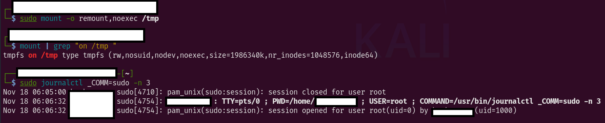
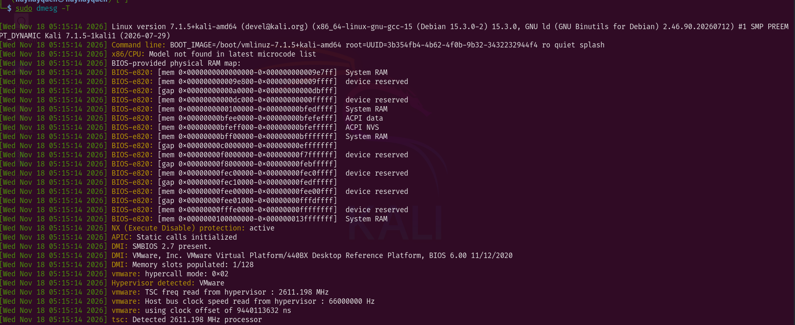
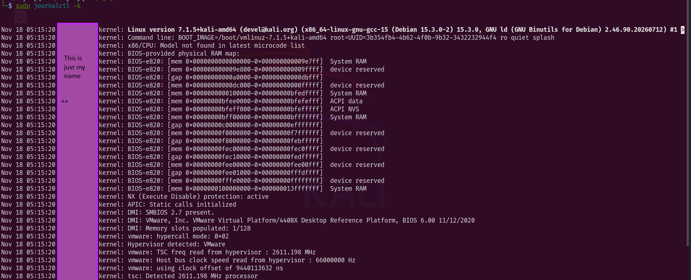
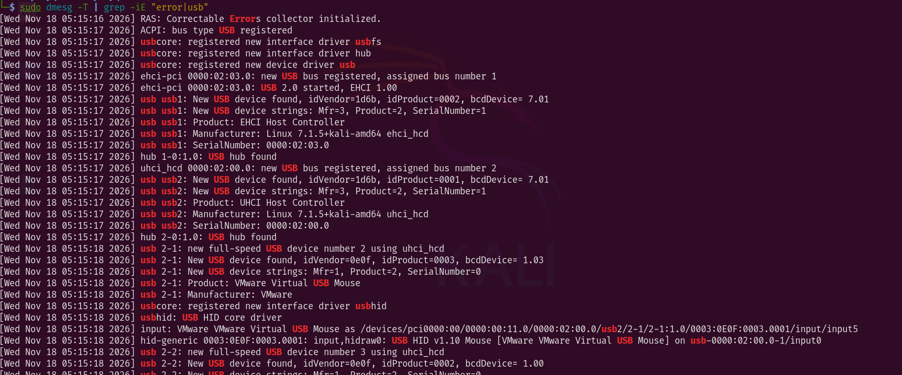

# Linux Logs

## 1. Logging Mechanisms
Linux divides system logging into two primary streams:
>* **Kernel Logs:** Generated by the Linux kernel to record hardware events, driver operations, loaded/unloaded kernel modules, filesystem mounts, and critical system errors (such as kernel panics)

>* **User Logs:** Capture interactions between users, applications, and the operating system, including login attempts, privilege escalation commands (`sudo`), and background daemon activities

---

## 2. Kernel Logs and the Kernel Ring Buffer
The Linux kernel uses the **Kernel Ring Buffer** — a circular memory buffer that temporarily stores log messages from the earliest stages of system boot (before logging daemons start) through active runtime

### SOC Monitoring Use Cases
* **Rootkit Detection:** Identifying hidden kernel modules or anomalous kernel behavior
* **Unauthorized USB Activity:** Monitoring peripheral device insertions and removals
* **Filesystem Abuse:** Detecting unauthorized remounting of `/` or `/tmp` with execution permissions (`exec`)  
 <u>**For example:**</u> 
 This tells absolute what i did before ^^
* **Boot-Time Persistence:** Inspecting suspicious modules loaded automatically during startup
* **Privilege Escalation:** Identifying kernel exploit indicators and memory corruption attempts

### Commands
These commands below will illustrate how to use command line to see logs in linux OS

> View kernel logs with human-readable timestamps  
sudo dmesg -T

> Read kernel messages directly via systemd-journald  
sudo journalctl -k
  

and this is a another example  
> Filter for hardware errors or USB device activity  
sudo dmesg -T | grep -iE "error|usb"
 

actually we have too much so now I can just say if you are interested in linux, try it yourself ^^