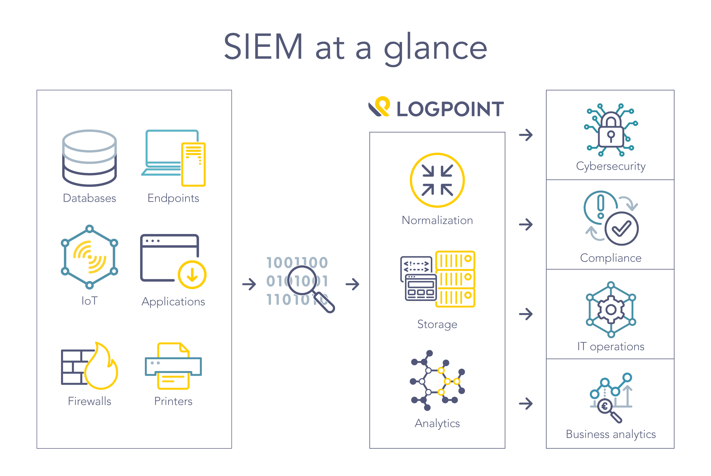

# SOC Tools

ok now let's see what we actually got  

## 1. SIEM

The question is what is this hmm....
> Central system that collects, aggregates, correlates, and analyzes logs from across your environment  
  

This is exactly where we work every single day. This called splunk - one of SIEM tools that we use within triage phase. without this, we probably miss some important event that correlated to malicious activities 😎  
## 2. SOAR
>SOAR platforms automate incident response using playbooks, reducing manual work and response time  

It's just like a "brain" that connects other security tools together and controls them using available rules (playbooks)

## 3. TIP (Threat Intelligence Platform)
This is absolutely what we use to save our time  
> TIP provides security teams with information on known malware and other threats

<u>***For example:***</u>
Just imagine that attacker send us a malware, basically we have to analyze it but in this case let's see this is an old malware which means that there's someone else did so now we just bring this file (its IOCs like hash) to TIP and then if it tells that "this file is marked as malicious since other people analyzed it" at a result we don't need to spend time on it at all

## 4. NTA (Network Traffic Analysis)
>Analyzing network traffic to detect security threats, performance issues, and other anomalies  

<u>***For example:***</u> open-source called **wireshark** allows deep packet insection
## 5. IDS/IPS
> IDS (Intrusion Detection System):  Monitors network traffic for suspicious activity, such as malware, unauthorized access attempts, and unusual traffic patterns

>IPS (Intrusion Prevention System): 
Similar to IDS, IPS also monitors network traffic for malicious activity

The thing is that what is a basic difference between them ? Actully I also have a couple of question marked around that.   

*Why we need these two separete thing whilst we can just simply use IPS to prenvent our system from malicious activities ?*
>Here is the answer

As picture demonstrates, IPS will block any suspicious traffic following its policy. If a package bypasses (allowed IP source/destinaton or port), it's not a totally safe package which we need to monitor it  
<u>***For example:***</u> package with port 2006 is marked as normal but attacker use it to disguise normal activity bypassing firewall and IPS rule. This is where IDS comes in as it will continue to monitor and trigger alerts if needed 
