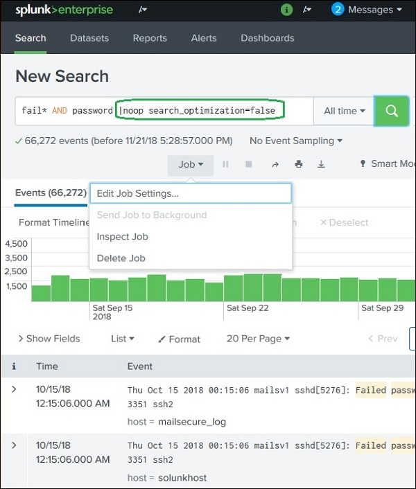
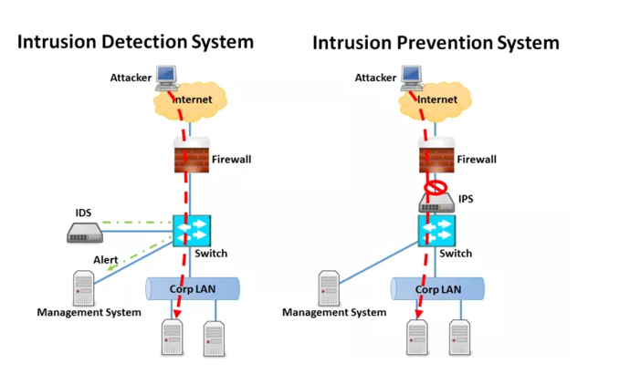

# SOC Tools

ok now let's see what we actually got  

## 1. SIEM

The question is what is this hmm....
> Central system that collects, aggregates, correlates, and analyzes logs from across your environment  
  

This is exactly where we work every single day. This called splunk - one of SIEM tools that we use within triage phase. without this, we probably miss some important event that correlated to malicious activities 😎  
## 2. SOAR
>SOAR platforms automate incident response using playbooks, reducing manual work and response time  

It's just like a "brain" that connects other security tools together and controls them using available rules (playbooks)

## 3. TIP (Threat Intelligence Platform)
This is absolutely what we use to save our time  
> TIP provides security teams with information on known malware and other threats

<u>***For example:***</u>
Just imagine that attacker send us a malware, basically we have to analyze it but in this case let's see this is an old malware which means that there's someone else did so now we just bring this file (its IOCs like hash) to TIP and then if it tells that "this file is marked as malicious since other people analyzed it" at a result we don't need to spend time on it at all

## 4. NTA (Network Traffic Analysis)
>Analyzing network traffic to detect security threats, performance issues, and other anomalies  

<u>***For example:***</u> open-source called **wireshark** allows deep packet insection
## 5. IDS/IPS
> IDS (Intrusion Detection System):  Monitors network traffic for suspicious activity, such as malware, unauthorized access attempts, and unusual traffic patterns

>IPS (Intrusion Prevention System): 
Similar to IDS, IPS also monitors network traffic for malicious activity

The thing is that what is a basic difference between them ? Actully I also have a couple of question marked around that.   

*Why we need these two separete thing whilst we can just simply use IPS to prenvent our system from malicious activities ?*
>Here is the answer

As picture demonstrates, IPS will block any suspicious traffic following its policy. If a package bypasses (allowed IP source/destinaton or port), it's not a totally safe package which we need to monitor it  
<u>***For example:***</u> package with port 2006 is marked as normal but attacker use it to disguise normal activity bypassing firewall and IPS rule. This is where IDS comes in as it will continue to monitor and trigger alerts if needed 

## 6. EDR (Endpoint Detection and Response)
> Monitors and responds to suspicious endpoint activity with real-time detection, isolation, and forensics  

Let's make the comparison to see what main differences antiVirus
| Feature | Traditional Antivirus (AV) | Endpoint Detection & Response (EDR) |
| :--- | :--- | :--- |
| **Primary Function** | Detect and block known malware | Detect, investigate, and respond to advanced endpoint threats |
| **Detection Method** | Signature-based (known threats) | Behavioral analysis + machine learning + IOC correlation |
| **Visibility** | Limited to file-based malware | Full endpoint visibility (processes, memory, registry, network) |
| **Response Capability** | Quarantine or delete infected files | Isolate endpoint, kill process, collect forensics, rollback changes |
| **Threat Types Covered** | Mostly known viruses, trojans | Advanced threats: fileless malware, ransomware, lateral movement |
| **Incident Investigation** | Not built-in | Built-in investigation tools (e.g., timeline, process tree) |
| **Automation/Integration** | Usually standalone | Integrates with SIEM/SOAR, supports automated response |
| **Use Case** | Basic endpoint protection | Advanced threat detection and IR in SOC environments |
## 7.Vulnerability Assessment Tools
> Scan systems and applications to identify known security weaknesses before attackers can exploit them  

Basically these tools help us identify vulnerabilities real quick
<u>***For example:***</u> scanning for open port or XSS flaws, etc... 😁
## 8.Ticketing Tools
> Track, assign, document, and escalate security incidents throughout their lifecycle  

 | Tool | Use Case / Notes |
| :--- | :--- |
| **ServiceNow** | Most common in enterprises, customizable workflows, integrates with SOAR/SIEM |
| **JIRA (Atlassian)** | Widely used for IT/security tasks, often used with Agile teams |
| **RT (Request Tracker)** | Lightweight, open-source alternative |
| **Zendesk** | Sometimes used in smaller orgs for support-style incidents |
| **TheHive** | Purpose-built for SOC/IR ticketing with native case management & observables |
| **Freshservice** | Used in some managed SOCs or MSSPs |

## 9.Sandboxing Tools
> Safely execute suspicious files or links in isolated environments to observe malicious behavior  

This is like a tool that help us analyze malware safely. Perharps I will use it later 🐱🐱🐱
## 10. UEBA (User and Entity Behavior Analytics)
> Detects insider threats and compromised accounts by identifying deviations from normal user behavior
## 11. Deception Tools
> Deploy fake assets like honeypots and tokens to trick attackers and detect intrusions early.

| Term | What It Is | Purpose |
| :--- | :--- | :--- |
| **Honeypot** | A **decoy system or service** that mimics a real asset (e.g., web server, SSH server) | Lure attackers and study their behavior |
| **Honeynet** | A **network of honeypots** designed to appear as a real enterprise network | Study large-scale attack campaigns and lateral movement |
| **Honeymap** | A **visual map** of honeypot activity around the world (real-time) | Visualize attacks by source IP, country, method |
| **Honeytoken** | A **fake piece of data** (like a document or API key) that alerts you when touched | Lightweight tripwire (used in canarytokens) |
