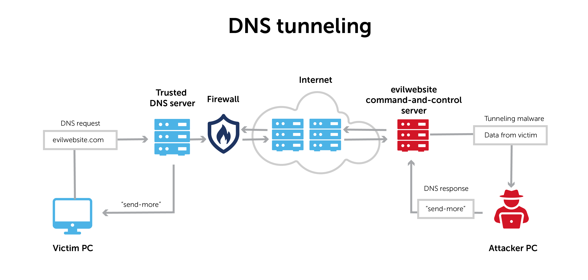
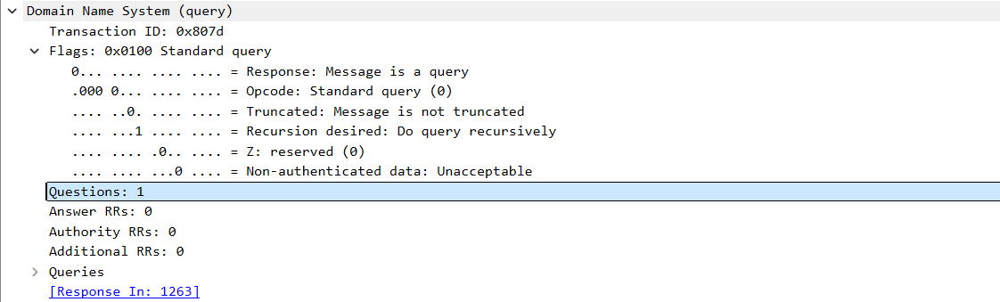
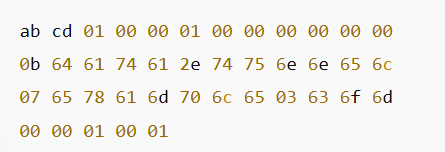
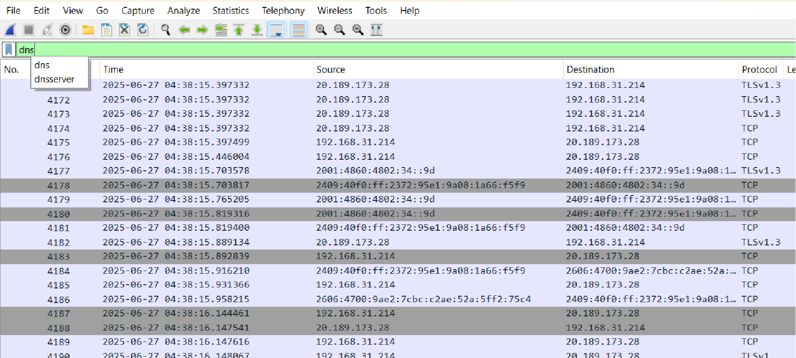
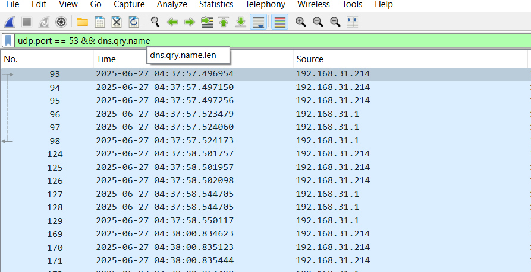

# DNS Tunnelling and Beaconing

## 1. DNS (Domain Name System)
* **Concept:** DNS acts like the internet’s phonebook, translating human-friendly domain names (e.g., `www.example.com`) into IP addresses (e.g., `93.184.216.34`) so computers can communicate with each other
* **Analogy:** Imagine asking a hotel concierge for a room number when you only know the guest’s name — DNS is that concierge

---

## 2. What is DNS Tunnelling?
* **Tunneling:** The practice of encapsulating one protocol inside another to bypass restrictions or firewall filters (e.g., a spy hiding secret messages inside an innocent-looking postcard).
* **DNS Tunnelling:** A technique that encodes data from other protocols (HTTP, SSH, raw files, etc.) into DNS queries and responses to bypass firewalls, exfiltrate data, or establish Command-and-Control (C2) channels.

### How Does It Work? (5 Steps)
1. **Infrastructure Setup:** The attacker controls a domain (e.g., `attacker.com`) and configures its authoritative DNS server to run a tunneling tool (`iodine`, `dnscat2`).
2. **Sending Encoded Queries:** Malware on the victim's machine encodes data (using Base32/Base64) into a subdomain, such as `dGhpcyBpcyBhIHRlc3Q.attacker.com`, and sends it to the local DNS resolver, which forwards it to the attacker's DNS server.
3. **Decoding at C2:** The attacker's DNS server extracts and decodes the subdomain to recover the stolen data (credentials, system info, etc.).
4. **Responding with Commands:** The C2 server sends encoded data or commands back to the victim via DNS response records (such as `TXT` or `CNAME`).
5. **Bi-Directional Communication:** This loop repeats continuously, establishing a full two-way covert communication channel.

 

---

## 3. Structure of a DNS Query and Data Hiding Location

### DNS Header Fields (First 12 Bytes)
| Field | Size (bits) | Purpose |
| :--- | :---: | :--- |
| **Transaction ID** | 16 | Random ID to match the query with its response |
| **Flags** | 16 | Identifies message type (Query/Response), opcode, recursion, etc. |
| **Questions** | 16 | Number of questions (usually set to `1`) |
| **Answer RRs** | 16 | `0` for a query packet |
| **Authority RRs** | 16 | `0` for a query packet |
| **Additional RRs** | 16 | `0` for a query packet |

 

### Question Section (Where Tunneling Hides Data)
* Normally, the `QNAME` field holds the domain name being resolved. In DNS tunneling, `QNAME` becomes the covert channel, looking like: `YWJjMTIzLmRhdGEudG9ubmVsLmV4YW1wbGUuY29t`.
* **Technical Limits:** The domain name is split into dot-separated labels (e.g., `abc123.data.tunnel.example.com`). Each label can hold up to **63 bytes**, and the entire domain name must be **≤ 255 bytes**. Tools like `iodine`, `dnscat2`, and `dnsteal` break large payloads into chunks to fit across multiple queries.

 

---

## 4. Practical Example of DNS Tunneling
So now, we will take a look at an prime instance in this case to what's going on😎😎😎  
> Suppose a compromised client wants to send the command `whoami` to a C2 server at `tunnel.attacker.com`:

1. **Victim Side (Client) Encodes and Sends:**
   * Original command: `whoami` $\rightarrow$ Base32 encoded: `OJQWIZJAMU======`
   * Embedded into the query domain (`QNAME`): `ojqwizjamu.tunnel.attacker.com` (Query Type: `A`, Class: `IN`).
2. **Attacker Side (C2 Server) Processes:**
   * Strips out the subdomain `ojqwizjamu` and Base32-decodes it back into `whoami`
   * Executes the command and sends the result (e.g., `"user: admin"`) back to the victim inside a **DNS TXT** record encoded in Base64: `dXNlcjogYWRtaW4=`

---

## 5. How to Detect DNS Tunnelling

 
 

### This is exactly what we notice ^^
* **Long and random-looking domains:** Subdomains with unusual lengths containing nonsensical character strings typical of encoding (Base32/Base64)
* **Continuously changing subdomains:** Rapid series of queries sent to the same root domain with varying prefixes to transmit fragmented data and bypass DNS caching
* **Abnormal query frequency:** Sudden spikes in DNS traffic (hundreds of packets) directed toward a single destination, or repetitive queries sent at fixed, regular intervals (beaconing)
* **Unusual DNS record types:** Unexpected volume of queries or responses utilizing `TXT` (type 16), `NULL` (type 10), or `Reserved` (type 0) records to carry C2 payloads

---

## 6. What is DNS Beaconing?
>When a compromised host repeatedly sends out DNS queries at regular intervals to an attacker-controlled domain to "check in," poll for new commands, or exfiltrate small bits of data without generating noticeable network noise
* **Workflow:**
  1. **Infection Stage:** Malware is dropped and executed on the victim host
  2. **Beaconing Begins:** Every X seconds or minutes, the host sends a DNS query formatted like `<random_id>.checkin.c2domain.com`
  3. **C2 Response:** The attacker's DNS server logs the check-in and may reply with a `TXT` record containing a Base64-encoded command
  4. **Execution:** The malware parses the response, executes any received instructions, and waits for the next beacon interval

---

## 7. Summary
* **DNS Tunneling** hides data and commands inside DNS subdomains using Base32/Base64 encoding to bypass firewalls
* **DNS Beaconing** maintains stealthy persistence by allowing malware to periodically check in with a remote C2 server
