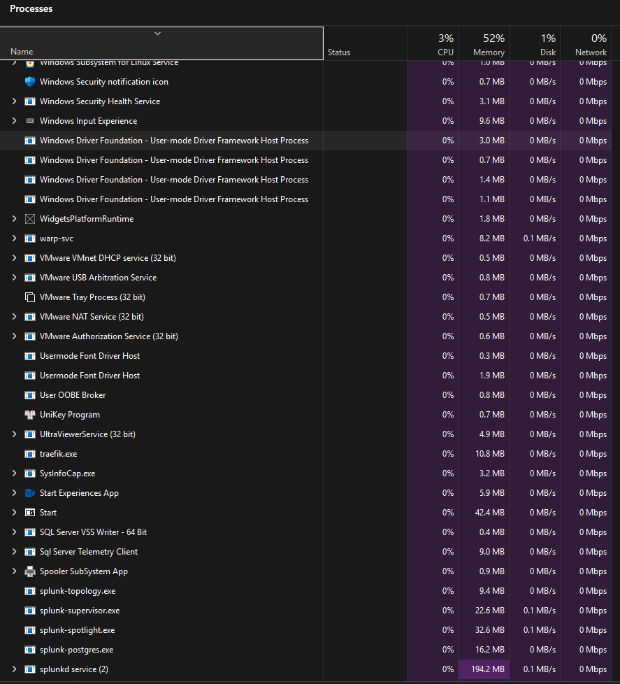
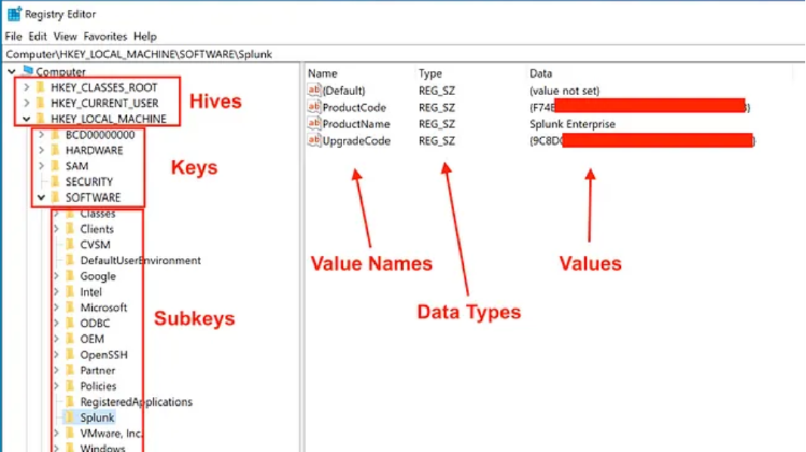

# Windows Core Processes, Registry And Logs 

##  1. Windows Core Processes  
### What are Core Processes?

> Theoretically, windows core processes are the essential system processes that launch during boot and keep the operating system stable, secure, and responsive. As a SOC analyst, knowing these helps us distinguish between normal system behavior and malicious activity masquerading as legitimate  

Just simply click `ctrl + shift + esc` and boommmm👌As we see below, these are all processes
 

### The Windows Process Lifecycle (What Happens at Boot)

| Stage / Order | Process(es) | Role at Boot |
| :--- | :--- | :--- |
| **1** | `smss.exe` | Starts sessions |
| **2** | `wininit.exe`, `csrss.exe` | Get started |
| **3** | `services.exe` | Spins up system services |
| **4** | `lsass.exe` and `winlogon.exe` | Manage logon |
| **5** | `explorer.exe` | User shell |

### Detailed Breakdown of Core Processes

| # | Process Name | Full Name / Role | Description | Security & Malware Considerations |
| :--- | :--- | :--- | :--- | :--- |
| **1** | `smss.exe` | Session Manager Subsystem | `smss.exe`, or the Session Manager Subsystem, is a critical Windows process responsible for initializing the user environment during the Windows startup sequence. It is one of the first processes to run after the kernel and is essential for creating user sessions and setting up the necessary environment for other processes to execute. | **Potential for Malware:** While `smss.exe` is a legitimate Windows process, malware can sometimes disguise itself as `smss.exe` and reside in a different location. If you find `smss.exe` in a location other than `C:\Windows\System32`, it could be a sign of malware. |
| **2** | `lsass.exe` | Local Security Authority Subsystem Service | `LSASS.exe`, or the Local Security Authority Subsystem Service, is a crucial system process in Windows that handles security policy enforcement. It's responsible for user authentication, password changes, and creating access tokens. It also writes to the Windows Security Log and is essential for Active Directory domain controllers, handling lookups, authentication, and replication. | Because of its role in storing sensitive information like credentials, LSASS is a frequent target for attacks, including credential dumping. |
| **3** | `svchost.exe` | Service Host | `svchost.exe` is a legitimate Windows system process that acts as a host for various Windows services. It's a shared-service process, meaning it allows multiple Windows services to run within a single process, which helps to reduce overall resource consumption. `svchost.exe` is like the Swiss Army knife of Windows processes: essential, multifunctional, and unfortunately, a favorite disguise for attackers. | While `svchost.exe` is essential for Windows functionality, it can sometimes be targeted by malware, which may disguise itself as a legitimate `svchost.exe` process *(see exploitation details below)*. |
| **4** | `csrss.exe` | Client/Server Runtime Subsystem | `Csrss.exe`, or Client/Server Runtime Subsystem, is a crucial process in Windows operating systems. It's a core component of the Win32 subsystem and handles tasks like managing graphical instructions, console applications, and system shutdowns. It's not something users interact with directly, but it's essential for the proper functioning of Windows.  Imagine the Windows OS as a theater production. The actors on stage are applications like Chrome, Notepad, Word — the stuff users interact with. The audience is the user, watching and interacting with the performance. But behind the scenes, someone has to make sure the curtain opens, the lights go on, the stage is built, and the actors get their cues. That's `csrss.exe` — the backstage crew running the essential, low-level support work so that applications can “perform.” | While it's a legitimate process, malware can sometimes disguise itself as `csrss.exe`, so it's important to know how to differentiate between the real and fake files. |
| **5** | `dllhost.exe` | Dynamic Link Libraries (COM Surrogate) | `dllhost.exe` is a legitimate Windows process that acts as a host for Component Object Model (COM) objects, specifically running DLLs (Dynamic Link Libraries) in a separate process. It's essentially a way for Windows to run code from DLLs in a more isolated and secure environment. | While usually safe, malware can sometimes disguise itself as `dllhost.exe`, so it's important to verify its location and behavior. |
| **6** | `explorer.exe` | Windows Shell / File Explorer | `explorer.exe` is a core Windows process responsible for the graphical interface, including the desktop, Start menu, taskbar, and File Explorer. It's essentially the shell that allows users to interact with the operating system. It's automatically started when a user logs in and remains active. | While `explorer.exe` is a legitimate Windows process, it can be targeted by malware, which may disguise itself as `explorer.exe` or exploit its functionality *(see operational details below)*. |
| **7** | `rundll32.exe` | Windows Host Process (Rundll32) | `rundll32.exe` is a legitimate Windows process that loads and executes functions stored in dynamic-link libraries (DLLs). | While essential for the operating system, it's frequently exploited by malicious actors to execute harmful code, making it a common target for threat detection *(see exploitation details below)*. |

### Specific Process Mechanics & Exploitation Methods

#### How Attackers Exploit `svchost.exe`

| Technique | Description |
| :--- | :--- |
| **Masquerading** | Malware can mimic `svchost.exe` by using similar names like `svhost.exe` or placing it outside the legitimate path (`C:\Windows\System32`). This helps it blend in with legitimate processes. |
| **Service Execution Abuse** | Attackers may install malicious services that run under `svchost.exe`, especially as `SERVICE_WIN32_SHARE_PROCESS` DLLs. These services inherit the legitimacy of `svchost.exe` while executing malicious code. |
| **Process Injection** | Malware can inject code into a legitimate `svchost.exe` process to evade detection and maintain persistence. |
| **Persistence via Registry** | Adversaries may create or modify registry keys to ensure their malicious service loads with `svchost.exe` on startup. |

#### `explorer.exe` Operational & Security Details

| Aspect | Description |
| :--- | :--- |
| **Startup** | It's launched by the `userinit.exe` process after a user logs in. |
| **Importance** | It's a critical process; if it crashes or stops responding, the graphical interface can become unresponsive or disappear. |
| **Troubleshooting** | If `explorer.exe` is causing issues, it can often be restarted by opening Task Manager (`Ctrl+Shift+Esc`), going to File > Run new task, and typing `explorer.exe`. |
| **Potential Problems** | Issues with `explorer.exe` can stem from various sources, including corrupted system files, background programs, or even malware. |
| **Malware** | While `explorer.exe` is a legitimate Windows process, it can be targeted by malware, which may disguise itself as `explorer.exe` or exploit its functionality. |

#### How Attackers Exploit `rundll32.exe`

| Technique | Description |
| :--- | :--- |
| **Malware Execution** | Because it can load and execute DLLs, `rundll32.exe` is frequently used by attackers to run malicious code, making it a common technique for bypassing security measures. |
| **Bypassing Security Measures** | By using `rundll32.exe`, attackers can sometimes bypass application control solutions, especially if those solutions are not configured to monitor DLL loading closely. |
| **Obscuring Malicious Activity** | Using `rundll32.exe` can make malicious activity harder to detect because it leverages a legitimate Windows process. |

### Core Processes Summary

| Process | Summary |
| :--- | :--- |
| `Smss.exe` | The Session Manager Subsystem starts user sessions and is one of the first processes to launch during Windows boot |
| `Lsass.exe` | The Local Security Authority handles user logins, stores credentials, and is a prime target for credential dumping tools |
| `Svchost.exe` | A service host process that runs DLL-based Windows services; frequently abused through LOLBin tactics or masquerading. |
| `Csrss.exe` | The Client/Server Runtime Subsystem manages console windows and thread creation, often targeted for stealthy injection |
| `Dllhost.exe` | The COM Surrogate process runs COM components in isolation and is used by attackers to sideload malicious DLLs |

---

##  2. Windows Registry & Logs

>### It's just like a Windows manor

### Windows Registry

The Windows Registry is a hierarchical database in Windows OS that stores settings and configurations for the OS, installed applications, and hardware devices. It's essentially the central repository for information that Windows needs to operate correctly

#### Registry Hierarchy Components

| Component | Description |
| :--- | :--- |
| **Hierarchical** | The registry is organized in a tree-like structure with keys, subkeys, and values. |
| **Root keys** | There are five main root keys, each representing a different category of settings: `HKEY_CLASSES_ROOT`, `HKEY_CURRENT_USER`, `HKEY_LOCAL_MACHINE`, `HKEY_USERS`, and `HKEY_CURRENT_CONFIG`. |
| **Keys and subkeys** | Keys are like folders, and subkeys are like subfolders within those folders, allowing for a nested structure. |
| **Values** | Values are the actual data stored within the keys and subkeys, and they can be of different types (e.g., strings, numbers, binary data). |

#### Registry Hives

| Hive | Path | Purpose | Red Flags |
| :--- | :--- | :--- | :--- |
| `HKEY_LOCAL_MACHINE (HKLM)` | `HKLM\` | System-wide settings (hardware, software, drivers) | Persistence via Services, tampering with SYSTEM |
| `HKEY_CURRENT_USER (HKCU)` | `HKCU\` | Per-user settings | Malware persistence via Run, RunOnce |
| `HKEY_CLASSES_ROOT (HKCR)` | `HKCR\` | File association and COM objects | Hijacking COM objects for DLL injection |
| `HKEY_USERS (HKU)` | `HKU\` | Settings for all users on the system | Changes to default user profile for mass persistence |
| `HKEY_CURRENT_CONFIG (HKCC)` | `HKCC\` | Hardware config used at boot | Rarely abused but changes may indicate low-level tampering |

#### Important Registry Paths SOC Analysts Must Monitor

| Path | Purpose | Threat |
| :--- | :--- | :--- |
| `HKLM\Software\Microsoft\Windows\CurrentVersion\Run` | Autostart apps (system-wide) | Malware autostarts at boot |
| `HKCU\Software\Microsoft\Windows\CurrentVersion\Run` | Autostart (per-user) | Less privileged, stealthy persistence |
| `HKLM\SYSTEM\CurrentControlSet\Services` | Windows services | Malware as fake or malicious service |
| `HKLM\Software\Microsoft\Windows NT\CurrentVersion\Image File Execution Options` | Debugger value can hijack programs | Used for Application Shimming |
| `HKLM\Software\Microsoft\Windows\CurrentVersion\ShellServiceObjectDelayLoad` | Loads DLLs on explorer startup | Rare & stealthy persistence |
| `HKCU\Software\Microsoft\Command Processor\AutoRun` | Runs commands before every CMD | Auto-executing malware when CMD is opened |
| `HKCU\Environment\UserInitMprLogonScript` | Executes script at logon | Used for login-based persistence |

### Windows Logs

Windows logs are records of events that occur within a Windows operating system. They are crucial for monitoring system health, troubleshooting issues, and gaining insights into application and system behavior. These logs capture a wide range of activities, from startup and shutdown sequences to errors, security events, and application-specific actions.

#### Types of Windows Logs

| Log Type | Description |
| :--- | :--- |
| **System Logs** | These logs record events related to the operating system itself, such as boot and shutdown sequences, device driver issues, and hardware malfunctions. |
| **Application Logs** | These logs track events generated by applications running on the system, including errors, warnings, and informational messages. |
| **Security Logs** | These logs record security-related events, such as user logins, failed login attempts, and access control changes. |
| **Setup Logs** | These logs track events related to system setup and configuration changes. |
| **Forwarded Events** | These logs collect events forwarded from other computers on the network. |

#### Key Windows Event IDs

| Event ID | Description | Use |
| :--- | :--- | :--- |
| `4624` | Logon successful | Brute force tracking |
| `4625` | Logon failed | Spray attempts |
| `4688` | New process creation | Malware execution |
| `4720` | New user created | Privilege escalation |
| `7045` | New service installed | Persistence |

As we already covered window OS stuff, next time we will discuss linux OS 
